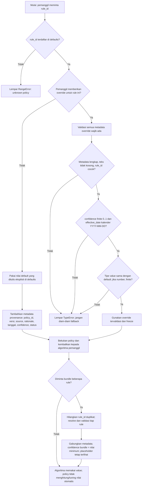
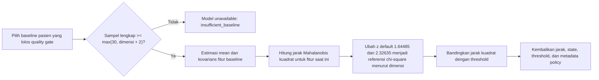

# Flowchart Penetapan Nilai `patientDecisionPolicies.js`

Dokumen ini menjelaskan asal nilai, proses pemilihan policy saat dipakai, dan
apa arti rationale dalam
[`config/patientDecisionPolicies.js`](../config/patientDecisionPolicies.js).

## Flowchart pemilihan policy

## Dari mana angka default berasal?

`patientDecisionPolicies.js` **tidak mengestimasi angka secara otomatis**.
Setiap `value` di objek `defaults` ditetapkan secara eksplisit dalam source
code. Rationale yang tertulis menjelaskan fungsi atau riwayat pemakaiannya;
sebagian besar menyatakan bahwa angka tersebut adalah konfigurasi perangkat
lunak yang sudah ada, dipertahankan untuk kompatibilitas/demo, atau perlu
validasi lebih lanjut. File ini tidak memberikan data kalibrasi, eksperimen
optimasi, atau sumber klinis yang membuktikan angka itu sebagai nilai
terbaik.

| Kelompok policy | Contoh nilai di file | Cara memahami nilainya |
|---|---|---|
| Kelengkapan baseline | `patient_mahalanobis_min_baseline_samples = 30`; `rr_maturing_min_windows = 30`; `rr_provisional_state_min_windows = 15` | Jumlah minimum yang dipakai untuk menahan perhitungan/menandai kematangan sampai tersedia cukup observasi menurut implementasi saat ini. Nilai tersebut bukan jaminan statistik atau klinis; `patient_mahalanobis` juga mensyaratkan `max(30, jumlah fitur + 2)`. |
| Ambang statistik | `patient_mahalanobis_mild_z_score = 1.6448536269514722`; `patient_mahalanobis_significant_z_score = 2.3263478740408408`; quantile CAPAR `0.90`, `0.95`, `0.99` | Angka z adalah nilai referensi distribusi normal yang dipakai untuk membentuk referensi chi-square; quantile adalah persentil untuk threshold yang dipelajari dari skor stabil. Keduanya adalah pembanding statistik, bukan cutoff klinis. |
| Persistensi dan waktu | `patient_persistence_positive_windows = 4` dari `patient_persistence_window_count = 5`; `patient_maximum_window_gap_minutes = 10`; `patient_prolonged_dwell_minutes = 15` | Mengendalikan jendela mana yang dihitung berurutan dan kapan kondisi software disebut persisten/berdurasi lama. Rationale menyebutnya konfigurasi demonstrasi, bukan definisi klinis. |
| Input dan kualitas sinyal | `rr_max_artifact_fraction = 0.05`; `rr_max_missing_fraction = 0.1`; `rr_min_valid_intervals = 45`; `wearable_min_signal_confidence = 0.7` | Quality gate untuk pemrosesan input wearable. Nilai perlu diuji terhadap sensor, firmware, kualitas pemasangan, dan data target; bukan rentang normal fisiologis. |
| Threshold state dan recovery | `episode_generate_tau_in = 1.5`; `episode_generate_tau_out = 1`; `rr_recovery_threshold_fraction = 0.5`; `patient_recovery_score_slope = -0.1` | Mengatur state machine/tren episode software yang ada. Nilai dipertahankan untuk perilaku algoritma, bukan hasil penetapan risiko medis. |
| Guard numerik dan penjelasan | `patient_deviation_minimum_baseline_std = 0.001`; `patient_deviation_zero_z_epsilon = 0.01`; `ablation_sigma_floor = 1` | Mencegah pembagian dengan variasi hampir nol atau menyaring perubahan numerik kecil. Ini parameter komputasi/penyajian, bukan batas fisiologis. |
| Prior populasi eksperimental | `rr_population_priors`, `ablation_population_priors` | Rationale menyebut prior ini rough/literature-inspired tanpa sitasi yang disediakan, dan hanya untuk perbandingan demonstrasi. Jangan menyajikannya sebagai nilai referensi klinis. |
| Safety/reporting behavior | `red_flag_chest_pain_enabled = true`; severity breathlessness `7`; symptom severity `9` | Mempertahankan perilaku eskalasi laporan pasien yang sudah ada. Cutoff skala memerlukan definisi dan governance klinis; label placeholder tetap wajib terlihat. |

### Contoh alur: nilai Mahalanobis

Nilai z tersebut adalah **parameter tetap yang dikonfigurasi**, bukan angka
yang dipelajari dari baseline pasien. Sebaliknya, mean dan kovarians dihitung
dari baseline pasien, sehingga jarak dan nilai threshold chi-square akhirnya
bergantung pada jumlah fitur. Lihat
[`utils/patientMahalanobis.js`](../utils/patientMahalanobis.js).

## Metadata default dan override

- Metadata default dibuat oleh `policyFor`: satu `policy_id`, versi, source,
  tanggal efektif, status, dan confidence dipasang pada setiap rule bersama
  rationale rule masing-masing.
- Konfigurasi saat ini bertanda `NON-CLINICAL / PLACEHOLDER`,
  `confidence: 0`, dengan source internal yang menyatakan tidak ada sumber
  klinis yang disediakan. Ini menjelaskan tingkat bukti konfigurasi saat ini;
  **bukan confidence algoritma terhadap keadaan seorang pasien**.
- Override tidak ditemukan dari environment variable atau database di modul
  ini. Override hanya digunakan jika caller secara eksplisit menyerahkan objek
  `policyOverrides` ke `getPatientDecisionPolicy` atau
  `getPatientDecisionPolicyBundle`.
- Override harus menyertakan metadata lengkap dan value dengan tipe yang sama
  seperti default; angka harus finite. Modul ini tidak menetapkan rentang
  domain tambahan untuk setiap rule, sehingga caller tetap bertanggung jawab
  mengirim angka yang bermakna bagi algoritma tersebut.
- Bundle menggabungkan rule unik. Confidence bundle adalah confidence minimum
  di antara rule; status `NON-CLINICAL / PLACEHOLDER` dipertahankan bila ada
  rule berstatus placeholder di dalam bundle.

## Kapan nilai boleh diubah?

Jangan mengubah angka hanya karena hasil tertentu terasa terlalu sensitif atau
terlalu jarang. Sebelum mengganti nilai untuk penggunaan yang lebih luas:

1. Tetapkan tujuan rule dan definisi outcome yang akan diukur.
2. Siapkan dataset representatif dan label/ground truth yang sesuai; pisahkan
   data tuning dan evaluasi agar evaluasi tidak mengukur ulang data tuning.
3. Tentukan metrik, biaya false positive/false negative, serta kriteria
   penerimaan sebelum mencari parameter.
4. Uji sensitivitas per perangkat, pengguna, kondisi, dan ketersediaan data;
   pastikan jalur insufficient-data dan nilai batas juga diuji.
5. Catat sumber, rationale, versi, tanggal efektif, serta proses governance pada
   policy. Jangan menaikkan `confidence` atau menghapus status placeholder
   sebelum bukti dan peninjauan yang sesuai tersedia.

Flowchart ini mendokumentasikan **cara kode memilih dan meneruskan nilai**, bukan
sertifikasi bahwa angka default sudah tepat untuk keputusan klinis.
