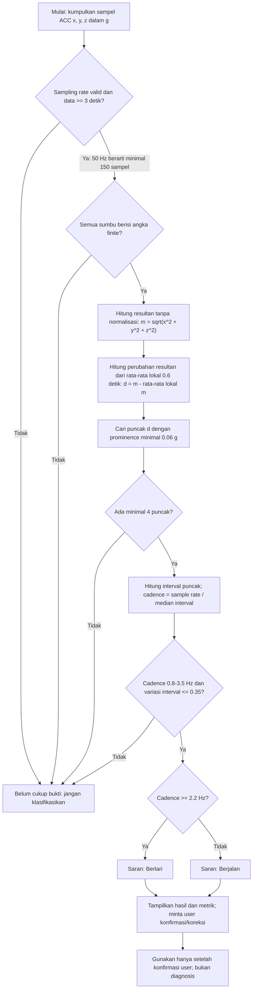
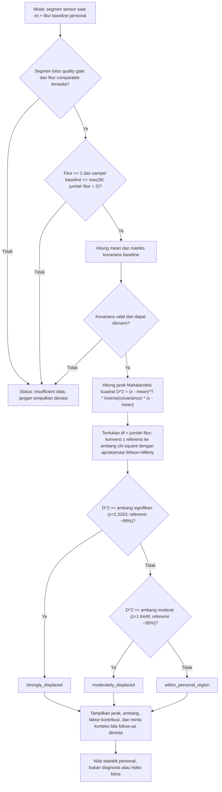
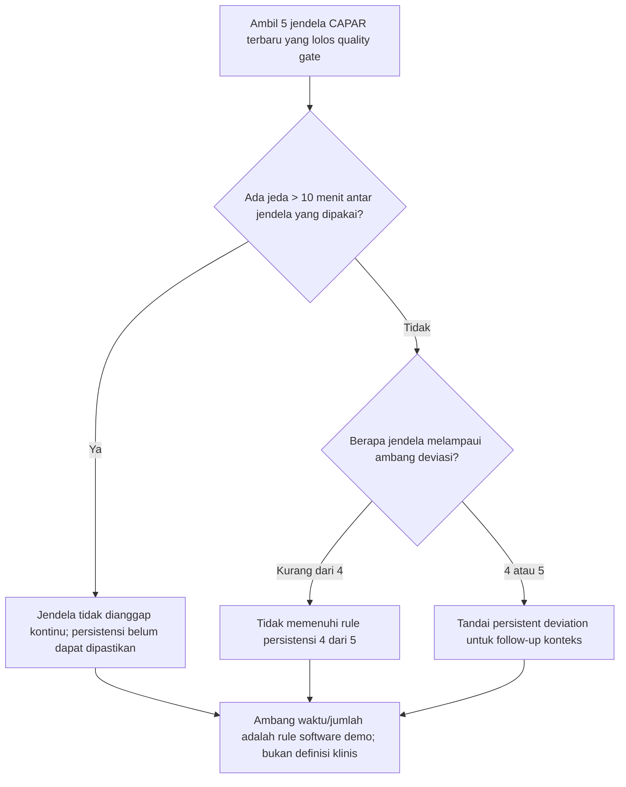

# Flowchart Penentuan Nilai Policy

Dokumen ini menjelaskan bagaimana nilai policy dipakai untuk menyaring sinyal
gerak dan membandingkan data pasien dengan baseline personal. Nilai yang
berstatus `NON-CLINICAL / PLACEHOLDER` adalah konfigurasi perangkat lunak untuk
demonstrasi, bukan hasil validasi klinis atau rekomendasi aktivitas.

## 1. Flowchart ACC: berjalan atau berlari

### Makna nilai ACC

| Policy | Nilai | Peran di algoritma | Asal/alasan dan batasan |
|---|---:|---|---|
| `minimumSampleSeconds` | 3 s | Menolak jendela terlalu pendek. Pada 50 Hz perlu sedikitnya 150 sampel. | Trade-off implementasi agar tersedia beberapa siklus gerak. Ini bukan nilai tervalidasi pada populasi. |
| Jendela rata-rata lokal | 0.6 s | Menjadi pembanding sesaat untuk resultan; selisih `d` menonjolkan perubahan cepat yang dipakai mencari puncak. | Parameter pemrosesan tetap di algoritma, bukan field policy. Dipilih sebagai heuristic untuk menonjolkan variasi berulang; belum divalidasi. |
| `minimumPeakProminenceG` | 0.06 g | Menolak puncak kecil/noise. | Nilai awal demo, bukan ambang gerak universal. Hasil sensitif terhadap pemasangan sensor dan noise. |
| `minimumCadenceHz` | 0.8 Hz | Batas bawah cadence yang dapat diterima. | Rentang heuristic untuk langkah berulang; belum dikalibrasi terhadap ground truth. |
| `runningCadenceHz` | 2.2 Hz | Mulai dari nilai ini saran berubah dari berjalan menjadi berlari. | Pemisah aktivitas heuristic, bukan batas fisiologis; cadence berjalan/berlari bisa tumpang tindih. |
| `maximumCadenceHz` | 3.5 Hz | Menolak cadence di atas rentang yang dianggap masuk akal oleh heuristic ini. | Batas demo; cadence ekstrem juga bisa berasal dari noise atau deteksi puncak ganda. |
| `maximumIntervalVariation` | 0.35 | Menolak urutan puncak yang tidak cukup teratur. Dihitung sebagai simpangan baku interval / rerata interval. | Ambang keteraturan heuristic, belum diuji untuk semua orang/aktivitas. |
| Jarak puncak minimum | 0.28 s | Menghindari dua puncak terlalu rapat dihitung sebagai dua langkah. | Konstanta implementasi. Ini membatasi cadence efektif sekitar 3.57 Hz, konsisten secara kasar dengan batas 3.5 Hz. |
| Jumlah puncak minimum | 4 | Memerlukan beberapa puncak untuk menghitung interval dan cadence. | Guard algoritmik minimum, bukan uji statistik formal. |

Nilai ACC tersebut tersimpan pada `ActivityMotionPolicy.demo` dan algoritmanya
ada di `WearableData.analyzeLocomotion` dalam
`lib/models/health_models.dart`. Policy mengembalikan `confidence: 0` dan status
`NON-CLINICAL / PLACEHOLDER`; artinya angka-angka ini **belum dipilih melalui
studi kalibrasi atau optimasi terhadap data berlabel**. Jangan menafsirkannya
sebagai alasan medis. Untuk mengubahnya menjadi nilai tervalidasi, kumpulkan
sampel ACC dengan label aktivitas/ground truth, uji lintas pengguna dan posisi
sensor, ukur false positive/false negative, lalu tetapkan kriteria penerimaan
sebelum tuning parameter.

## 2. Flowchart ambang deviasi personal CAPAR

### Bagaimana ambang CAPAR didapat

1. Backend mengambil fitur sebanding dari baseline personal yang lolos quality
   gate. Tanpa sekurangnya dua fitur, atau tanpa
   `max(30, jumlah_fitur + 2)` sampel baseline lengkap, hasil ditandai
   `insufficient_data`.
2. Model menghitung mean dan kovarians baseline. Kovarians diberi regularisasi
   numerik kecil agar inversi lebih stabil; kegagalan inversi berarti model
   tidak tersedia, bukan “normal”.
3. Jarak dihitung sebagai `D^2 = (x - mean)^T * inverse(covariance) * (x -
   mean)`. Ini memperhitungkan skala fitur serta korelasi di baseline personal.
4. Policy memakai nilai referensi `z=1.6448536` dan `z=2.3263479`, kira-kira
   kuantil satu sisi 95% dan 99% pada distribusi normal standar. Kode
   mengubahnya menjadi nilai referensi chi-square berdasar jumlah fitur
   menggunakan aproksimasi Wilson-Hilferty. Karena itu ambang numeriknya
   bergantung pada dimensi fitur; angka z bukan ambang langsung untuk `D^2`.
5. Klasifikasi membandingkan **jarak kuadrat** dengan ambang chi-square.
   Ambang ini adalah referensi statistik teoritis, bukan cutoff yang dipelajari
   dari hasil klinis pasien. Jarak Mahalanobis sendiri bukan skor risiko medis.

## 3. Flowchart persistensi episode

`4 dari 5` dan jeda maksimum `10 menit` adalah policy persistensi software yang
ada saat ini. Konfigurasi menyebutnya sebagai nilai demonstrasi yang perlu
divalidasi; nilai itu tidak membuktikan kondisi klinis dan tidak semestinya
dipakai sebagai kriteria diagnosis.

## Sumber implementasi

- ACC: `lib/models/health_models.dart` (`ActivityMotionPolicy.demo` dan
  `WearableData.analyzeLocomotion`).
- Ambang deviasi: `../api/config/patientDecisionPolicies.js` dan
  `../api/utils/patientMahalanobis.js`.
- Persistensi: `../api/config/patientDecisionPolicies.js` dan
  `../api/utils/patientPedagogy.js`.
- Definisi kontrak dan keterbatasan: `../api/docs/patient-app-api.md`.
